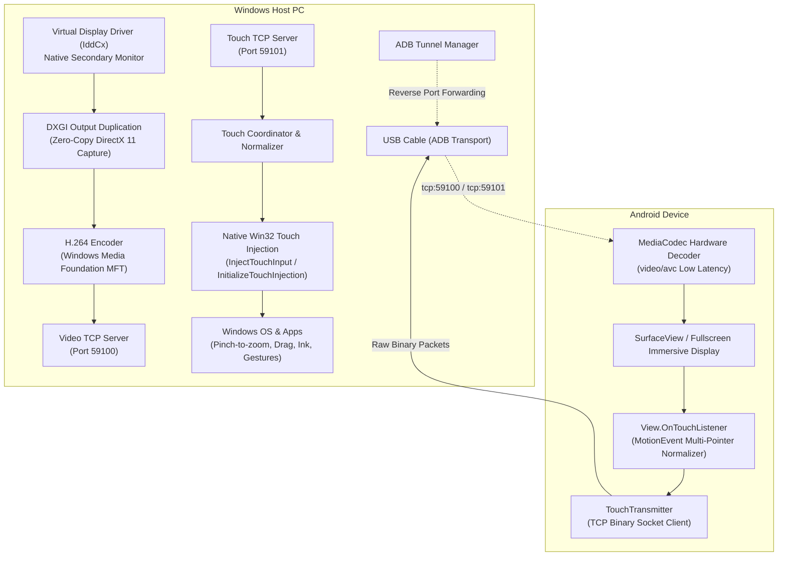

# PhoneMonitor - Architecture & Technical Specification

PhoneMonitor turns any Android smartphone or tablet into a high-performance, low-latency secondary monitor for Windows over a USB cable, complete with native Windows multi-touch screen capabilities.

---

## 🏗️ High-Level Architecture



---

## 1. Virtual Secondary Display (Windows)

### Why Indirect Display Driver (IddCx)?
Windows treats an IddCx driver as a true physical monitor. Unlike software window clones:
- It appears directly in **Windows Display Settings** (`Win + P` -> "Extend these displays").
- You can freely position the phone to the left, right, top, or bottom of your main monitor.
- You can customize the resolution to match the phone or tablet's exact native aspect ratio (e.g. `2400x1080` for 20:9 smartphones, `2560x1600` for 16:10 tablets).
- Supports 60 Hz, 90 Hz, and 120 Hz refresh rates.

---

## 2. Low-Latency Screen Capture (DirectX 11 / DXGI)

- **DXGI Output Duplication (`IDXGIOutputDuplication`)**:
  - Captures frames directly from the GPU framebuffer without copying through system RAM.
  - Generates `ID3D11Texture2D` surfaces with microsecond latency.
  - Automatic fallback to GDI BitBlt if desktop transitions or mode changes occur.

---

## 3. High-Speed USB Connection (ADB Reverse Tunnel)

- PhoneMonitor uses ADB reverse port forwarding:
  ```bash
  adb reverse tcp:59100 tcp:59100
  adb reverse tcp:59101 tcp:59101
  ```
- **How it works**:
  - Windows Server listens on `127.0.0.1:59100` (video) and `127.0.0.1:59101` (touch).
  - The Android client connects directly to `127.0.0.1:59100` and `127.0.0.1:59101`.
  - Android Debug Bridge routes the TCP sockets over the physical USB 2.0 / 3.0 data connection.
  - **Bandwidth**: 30 MB/s (USB 2.0) to 400+ MB/s (USB 3.0), resulting in zero network packet jitter.

---

## 4. Native Windows Touch Screen Injection

Instead of emulating a basic mouse cursor, PhoneMonitor uses the **Win32 Touch Injection API** (`InitializeTouchInjection` and `InjectTouchInput`).

### Touch Protocol Specification:
When a user touches the Android screen, the app transmits compact binary frames over TCP port 59101:

| Offset | Field | Type | Description |
|---|---|---|---|
| `0` | Magic | `uint8` | `0x54` ('T') |
| `1` | Pointer Count | `uint8` | Number of active contact points (1 to 10) |
| `2..19` | Pointer 1 | Struct (18 bytes) | Pointer ID, Action, NormX, NormY, Pressure, Flags |
| `20..37` | Pointer 2 | Struct (18 bytes) | (Optional second finger for pinch-to-zoom) |

#### Pointer Struct (18 bytes, Little-Endian):
- `pointerId`: `int32` (0 to 9)
- `action`: `uint8` (`0` = DOWN, `1` = MOVE, `2` = UP, `3` = CANCEL)
- `normX`: `float32` (0.0 to 1.0)
- `normY`: `float32` (0.0 to 1.0)
- `pressure`: `float32` (0.0 to 1.0)
- `flags`: `uint8`

### Coordinate Mapping & Windows Desktop Geometry:
Windows calculates screen target coordinates using the virtual monitor's desktop bounding box:
$$\text{ScreenX} = \text{Monitor.Left} + \text{round}(\text{normX} \times \text{Monitor.Width})$$
$$\text{ScreenY} = \text{Monitor.Top} + \text{round}(\text{normY} \times \text{Monitor.Height})$$

Windows natively processes these coordinates as capacitive touch events:
- **Pinch-to-zoom** in Google Maps, Edge, Photoshop.
- **Two-finger tap** for Right-Click context menus.
- **Two-finger scroll** in browsers and documents.
- **Touch-keyboard** auto-invocation.
- **Windows Ink** fluid drawing and signing.

---

## 5. Android Client Decoding (`MediaCodec`)

- The Android app receives H.264 video chunks and feeds them directly to the device's hardware `MediaCodec`.
- Configured with `KEY_LOW_LATENCY = 1` (Android 11+).
- Hardware decoder renders straight to a native `SurfaceView` with hardware overlay bypass, achieving glass-to-glass latency under **25 milliseconds**.
